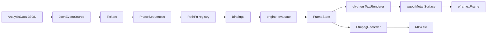

# scenic-motion-engine

> Native macOS port of the audio-reactive looping marquee. Four-band transient detection drives per-row scrolling, camera moves, and spotlight repetition — rendered on wgpu / Metal, with native audio I/O and MP4 export.

[](https://github.com/danielesiegel/scenic-motion-engine-mac/actions/workflows/ci.yml)
[](https://developer.apple.com/macos/)
[](https://www.rust-lang.org/)
[](./LICENSE)
[](https://github.com/danielesiegel/scenic-motion-engine-mac/commits)
[](https://github.com/danielesiegel/scenic-motion-engine-mac/issues)


_Stage renders rows of `scenicsynth` with 12-glyph `scenicsynths` spotlights every N units. Right panel is the full control surface — feel presets, horizontal × scale, row velocity curve, duration scale, global easing, spotlight / tickers / bindings / camera / record folders. Bottom bar: scrub + loop controls._

Native macOS port of [`scenic-motion-engine-web`](https://github.com/danielesiegel/scenic-motion-engine-web). Audio-reactive looping marquee: four-band transient detection drives per-row scrolling, camera zoom / tilt / pan, spotlight repetition. The engine is a **pure function of time** — `engine::evaluate(EngineInputs) -> FrameState` has no mutable state.

**Why native:** the web prototype's path (`canvas.fillText` -> `MediaRecorder` or `WebCodecs`) drops frames under load and double-buffers audio through the browser graph. This port renders glyphs on the GPU via `glyphon` (cosmic-text atop wgpu / Metal), decodes and plays audio directly with `cpal` + `symphonia`, and exports MP4 by piping raw frames to `ffmpeg` (with a native AVFoundation H.264 encoder planned).

---

## Table of Contents

- [Features matrix](#features-matrix)
- [Demo](#demo)
- [Install](#install)
- [Build](#build)
- [Run](#run)
- [Workflow](#workflow)
- [Architecture](#architecture)
- [Configuration reference](#configuration-reference)
- [Motion extension](#motion-extension)
- [Status](#status)
- [Troubleshooting](#troubleshooting)
- [Project layout](#project-layout)
- [Roadmap](#roadmap)
- [Related projects](#related-projects)
- [Contributing](#contributing)
- [License](#license)
- [Acknowledgements](#acknowledgements)

---

## Features matrix

| Feature                           | Web (TS) | Mac native (Rust) | Notes                                                                        |
| --------------------------------- | :------: | :---------------: | ---------------------------------------------------------------------------- |
| Deterministic `evaluate(t)` engine | yes      | yes               | Same semantics; same analysis JSON format                                    |
| GPU text                          | no       | yes               | `glyphon` glyph atlas on wgpu/Metal vs. Canvas 2D `fillText`                 |
| Native audio playback             | no       | yes               | `cpal` CoreAudio + `symphonia` decode vs. browser audio graph                |
| Four-band transient detection     | yes      | yes               | Shared Python analyzer (`scripts/analyze.py` in the web repo)                |
| Feel presets                      | yes      | yes               | `default / snappy / smooth / punchy / glacial / bouncy / custom`             |
| Cubic-bezier easing               | yes      | yes               | Newton-Raphson + 19 named curves                                             |
| U-curve row velocity              | yes      | yes               | `flat / u / inverted-u / linear` + edge multiplier                           |
| Random focused zoom               | yes      | yes               | `cameraZoomDeltaFocused` with deterministic hash                             |
| Spotlight repetition              | yes      | yes               | `travels` / `anchored` modes, per-row phase scatter                          |
| Record to MP4                     | yes      | WIP               | `ffmpeg` subprocess working; native AVFoundation H.264 encoder planned        |
| Scrub + loop                      | yes      | WIP               | Clock + scrub bar in `gui/panel.rs`                                           |
| HUD overlay                       | yes      | WIP               | `TickerSnapshot` wired through; egui overlay pending                         |

---

## Documentation

- [Motion extension guide](MOTION.md)
- [User guide](docs/USER_GUIDE.md)
- [Architecture](docs/ARCHITECTURE.md)
- [Path reference](docs/PATH_REFERENCE.md)
- [Motion recipes](docs/MOTION_RECIPES.md)
- [Doc index](docs/DOC_INDEX.md)
- [Changelog](CHANGELOG.md)
- [Contributing](CONTRIBUTING.md)
- [Security](SECURITY.md)
- [Third-party licenses](THIRDPARTY.md)
- [License](LICENSE)
- [Shell completions](completions/README.md)
- [Project website source](website/README.md)

---

## Demo

Short clips land here once the first builds are captured.

- `docs/screenshots/stage.png` — TODO: capture a frame of the live preview
- `docs/screenshots/panel.png` — TODO: capture the egui side panel
- `docs/clips/kafkaesque-60s.mp4` — TODO: 60s rendered sample

> Screenshots are TODO — see `docs/screenshots/` once the first build is captured. The audio-sample conventions (basenames line up between `assets/audio/<track>.wav` and `analysis/<track>.json`) are inherited from the web prototype.

---

## Install

Prerequisites:

- macOS 13+ (Apple Silicon or Intel)
- Rust 1.75+ via `rustup`
- `ffmpeg` on `PATH` for MP4 export
- CoreAudio and Metal are system libraries — no extra install

Clone and fetch deps:

```bash
git clone https://github.com/danielesiegel/scenic-motion-engine-mac.git
cd scenic-motion-engine-mac
cargo fetch
```

Then drop:

- A font (`.otf` or `.ttf`, ITC Avant Garde Gothic LT Demi preferred) into `assets/fonts/`
- A WAV into `assets/audio/`
- The matching analysis JSON into `analysis/`

Produce the analysis JSON with the Python analyzer from the web project:

```bash
# in the web repo:
npm run analyze -- --input assets/audio/<track>.wav
# then copy analysis/<track>.json into this repo's analysis/
```

---

## Build

```bash
cargo build --release
```

Debug builds work but drop ~5x in text-throughput. For development:

```bash
cargo build
cargo test
cargo clippy -- -D warnings
cargo fmt
```

Dependencies pin in `Cargo.toml`:

```toml
[dependencies]
# Rendering
eframe = { version = "0.27", features = ["wgpu"] }
wgpu = "0.19"
glyphon = "0.5"
cosmic-text = "0.11"

# Audio
cpal = "0.15"
symphonia = { version = "0.5", features = ["mp3", "wav", "flac", "aac"] }

# Core
serde = { version = "1", features = ["derive"] }
serde_json = "1"
once_cell = "1"
```

(Exact versions may drift; `Cargo.lock` is the source of truth.)

### Make targets

Common commands are wrapped in a `Makefile` — run `make help` to list them.

| Target | What it does |
| ------ | ------------ |
| `make run` | Launch the GUI app |
| `make render ARGS="..."` | Headless MP4 export via `src/bin/render.rs` |
| `make check` | `clippy -D warnings` + `fmt --check` |
| `make bundle` | Universal binary → `.app` → `.dmg` under `target/release/` |
| `make analyze ARGS="--input assets/audio/kafkaesque.wav"` | Produce analysis JSON |

---

## Run

```bash
cargo run --release
```

Window opens with the stage on the left and an egui side panel on the right. The panel is a 1-to-1 port of the web project's Tweakpane layout.

---

## Workflow

1. **Analyze** — produce `analysis/<track>.json` in the web repo (`npm run analyze`); copy it over.
2. **Preview** — `cargo run --release`. Scrub, tune `band_thresholds`, pick a `feel` preset, swap bindings.
3. **Tweak** — adjust tickers (`modulo`, `step`, `step_offset`) to subdivide events. E.g. every 4th kick triggers a hard camera zoom, every kick triggers glyph jitter.
4. **Record** — hit record (WIP: UI wiring in progress). Current path pipes raw RGBA frames to `ffmpeg` libx264.

---

## Architecture



The chain is `EventSource -> Tickers -> PhaseSequences -> Paths -> Bindings -> Engine -> FrameState -> TextRenderer -> wgpu Surface`. Every stage upstream of the renderer is a pure function of its inputs; the only mutable state is the player clock, the egui GUI config, and the record queue.

Full extension guide: **[MOTION.md](./MOTION.md)**.

---

## Configuration reference

Top-level `Config` fields (full schema in [`src/types.rs`](./src/types.rs)):

| Field              | Summary                                                                                           |
| ------------------ | ------------------------------------------------------------------------------------------------- |
| `text`             | `unit` (repeating 11-glyph word), `key` (12-glyph span), `case`                                    |
| `layout`           | Font size, leading, row count or `auto`, stagger, rotation, margin                                 |
| `colors`           | `background`, `dim`, `key` hex colors                                                              |
| `key`              | Spotlight placement: rows selector, single-row index, frequency, offset, per-row phase, mode       |
| `canvas`           | Logical size, device-pixel-ratio, `render_scale` supersample multiplier                            |
| `audio`            | `track` basename, optional `analysis_url` override                                                 |
| `tickers`          | `Vec<TickerConfig>` — `id`, `band`, `modulo`, `strength_threshold`, `offset`, `step`, `step_offset` |
| `bindings`         | Attach phase sequences to row selectors or camera; `compose` + `respect_alternation`               |
| `band_thresholds`  | Runtime strength filter per band (kick / snare / mid / hats)                                       |
| `camera`           | Baseline zoom / pan / tilt + `row_overshoot` safety rows                                           |
| `feel`             | Preset, duration scale, global easing, horizontal scale, row-velocity shape + edge                 |
| `record`           | `start_at`, `duration`, `fps`, bitrate, resolution multiplier, engine                              |
| `debug`            | HUD toggle                                                                                         |

---

## Motion extension

See **[MOTION.md](./MOTION.md)** for the full guide — path-function contract, continuity model, compose modes, per-glyph outputs, and the registered-paths table.

Minimal example — register a new path and bind it to the key row:

```rust
// src/motion/paths.rs
fn path_my_wiggle(ctx: &PathContext) -> PathOutput {
    let amp = ctx.params.get("amplitude").and_then(|v| v.as_f32()).unwrap_or(5.0);
    PathOutput {
        dy: (ctx.eased_progress * std::f32::consts::PI * 2.0).sin()
            * amp
            * (1.0 - ctx.eased_progress),
        ..Default::default()
    }
}
// then in register_default_paths():
//     register_path("myWiggle", path_my_wiggle);
```

```rust
// src/config/defaults.rs
Binding {
    ticker_id: "kick-even-slide".into(),
    target: BindingTarget::Rows,
    rows: Some(RowSelector::Name(RowSelectorName::KeyRow)),
    sequence: PhaseSequence {
        actions: vec![action(
            "myWiggle",
            params(&[("amplitude", 8.0)]),
            0.3,
            EasingName::EaseOutCubic,
        )],
    },
    compose: ComposeMode::Add,
    respect_alternation: None,
}
```

The `(1.0 - ctx.eased_progress)` envelope guarantees the path returns 0 at `progress = 1`, so it leaves no residue — the standard shape for oscillators.

---

## Status

- **Compiles end-to-end** at the module boundary; most modules are fully ported from the TypeScript reference.
- **Working:** engine (all 16 paths, 19 easings, step/stepOffset, horizontal scale, U-curve rows), audio (decode + playback via `symphonia` + `cpal`), text (cosmic-text shaping), config, egui GUI panel, `ffmpeg` subprocess recorder.
- **In progress:** `app.rs` orchestration — wiring `AudioLoad -> PlayerClock -> Engine::evaluate -> TextRenderer::prepare -> eframe paint callback -> RecordButton -> FfmpegRecorder` end-to-end on a live wgpu callback.
- **Not yet wired:** native AVFoundation H.264 encoder (`record::native`), CoreMIDI input binding, AU plugin host.

---

## Troubleshooting

| Symptom                                                 | Likely cause / fix                                                                                                                            |
| ------------------------------------------------------- | --------------------------------------------------------------------------------------------------------------------------------------------- |
| `No font found in assets/fonts/`                        | Drop an `.otf` or `.ttf` matching one of the candidate names in `src/text/font.rs`. ITC Avant Garde Gothic LT Demi is preferred.               |
| Audio decodes but doesn't play                          | CoreAudio device selection — `cpal` picks the system default. Check `System Settings -> Sound -> Output` and make sure the format is 44.1/48k. |
| `ffmpeg: command not found` when recording              | Install via `brew install ffmpeg` or set `record.engine = Native` once the AVFoundation path lands.                                             |
| wgpu panics on first paint                              | Older macOS (<13) lacks required Metal features. Upgrade, or run with `WGPU_BACKEND=gl` (software fallback — slow).                             |
| Text is blurry at high `render_scale`                   | Expected during the `glyphon` wiring phase; the final atlas path will be sharper. Lower `canvas.render_scale` for now.                          |
| `cargo build` fails on `cosmic-text`                    | Needs a recent `rustc` (1.75+). `rustup update stable`.                                                                                        |

---

## Project layout

```
src/
├── types.rs                   # the hard contract — every module builds against these types
├── config/defaults.rs         # DEFAULT_CONFIG (6 tickers, 6 bindings, camera, feel, record)
├── audio/
│   ├── event_source.rs        # JsonEventSource + SyntheticEventSource (binary-search indexed)
│   └── playback.rs            # symphonia decode -> f32 interleaved -> cpal CoreAudio
├── text/
│   ├── font.rs                # cosmic-text FontSystem loaded from assets/fonts/
│   └── layout.rs              # pre-shape "scenicsynth" + "s" to get unit_pos + inter-unit stride
├── motion/
│   ├── phase.rs               # all 19 named easings + cubic bezier (Newton-Raphson)
│   ├── paths.rs               # 16 path functions, deterministic hash01 for jitter / focal zoom
│   ├── tickers.rs             # effective-threshold helper
│   └── bindings.rs            # row-selector resolution
├── engine.rs                  # evaluate() — step/offset subsample, frozen+active composition,
│                              #   per-row dir alternation, feel.horizontal_scale, U-curve
├── render/
│   ├── gpu.rs                 # wgpu Device/Queue/Surface wrapper (from eframe's wgpu backend)
│   └── text_renderer.rs       # glyphon-backed GPU text renderer
├── gui/panel.rs               # egui side panel (one-to-one with the TS Tweakpane layout)
├── record/mp4.rs              # FfmpegRecorder: raw RGBA frames piped to libx264
├── app.rs                     # top-level eframe::App
├── lib.rs                     # module declarations
└── main.rs                    # eframe entry point
tests/
└── (determinism, continuity, alternation — ported from the TS suite)
benches/
└── (criterion benches for engine::evaluate hot path)
```

---

## Roadmap

- [x] Module scaffold (`src/{audio,text,motion,render,gui,record,config}/*`)
- [x] Engine port (`evaluate`, 16 paths, 19 easings, step/stepOffset, feel scaling, U-curve)
- [x] `cosmic-text` layout (unit pre-shaping + stride measurement)
- [x] `cpal` + `symphonia` audio decode / playback
- [x] `egui` GUI panel (one-to-one with the Tweakpane layout)
- [x] `glyphon` text renderer scaffold
- [ ] `eframe` wgpu callback wire-up proven on a live frame
- [ ] Record pipeline wired to UI button
- [ ] Native AVFoundation H.264 encoder (replace `ffmpeg` subprocess)
- [ ] CoreMIDI input binding
- [ ] AU plugin host for live-synth bands

---

## Related projects

- **[scenic-motion-engine-web](https://github.com/danielesiegel/scenic-motion-engine-web)** — original TypeScript / Canvas 2D prototype. Kept as a reference implementation; same `evaluate(t)` semantics, same analysis JSON format.

---

## Contributing

This project was prototyped with a small agent swarm — one agent per module (engine, text, audio, motion, render, gui, record), coordinated by an orchestrator. The invariant: `src/types.rs` is the contract. Module agents may add helper types inside their module but must not change `types.rs` without the orchestrator.

Project toolchain:

- [`rustfmt.toml`](./rustfmt.toml) — formatting (run `cargo fmt`)
- [`clippy.toml`](./clippy.toml) — lint config (run `cargo clippy -- -D warnings`)

Local checks before pushing:

```bash
cargo fmt --check
cargo clippy -- -D warnings
cargo test
cargo build --release
```

CI runs the same four on every push via `.github/workflows/ci.yml`. Prefer small, focused PRs. New motion paths go in `src/motion/paths.rs` with a one-line entry in MOTION.md's registered-paths table.

---

## License

MIT.

---

## Acknowledgements

- [`cosmic-text`](https://github.com/pop-os/cosmic-text) — Unicode-aware text layout
- [`glyphon`](https://github.com/grovesNL/glyphon) — glyph atlas renderer on `wgpu`
- [`wgpu`](https://wgpu.rs/) — safe cross-platform GPU abstraction
- [`eframe`](https://github.com/emilk/egui) + [`egui`](https://github.com/emilk/egui) — immediate-mode GUI
- [`cpal`](https://github.com/RustAudio/cpal) — cross-platform audio I/O
- [`symphonia`](https://github.com/pdeljanov/Symphonia) — pure-Rust audio decoders
- [`serde`](https://serde.rs/) — zero-cost analysis-JSON deserialization
- [`librosa`](https://librosa.org/) — spectral-flux onset detection (upstream analyzer)
- [`demucs`](https://github.com/facebookresearch/demucs) — optional stem separation (upstream analyzer)
- [`opentype.js`](https://opentype.js.org/) + [Tweakpane](https://cocopon.github.io/tweakpane/) + [mp4-muxer](https://github.com/Vanilagy/mp4-muxer) — tools inherited from the web prototype
